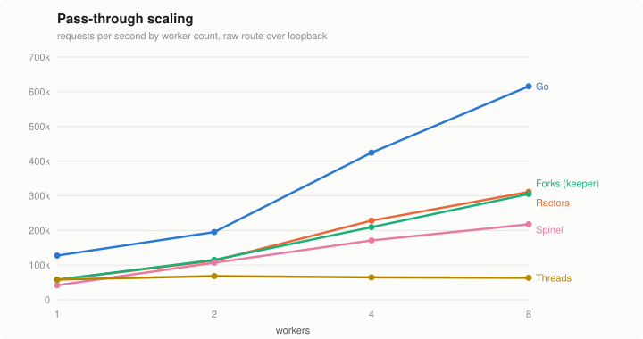
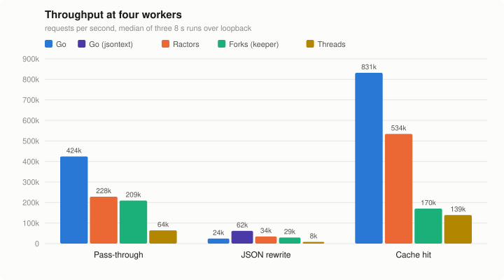

# Are We Fast Yet?

I wrote the same small API gateway twice, once in Ruby on Ractors and async fibers and
once in Go, to see how far a single Ruby process gets on four cores now that Ractors run
in parallel for real. The gateway routes by prefix, balances upstreams, rate-limits per
API key, caches responses, rewrites JSON and serves Prometheus metrics, and the rate-limit
windows, cache and counters are one copy shared by every worker. That last part is what
the Ractor version is about: forks have to go through another process to share anything.

## Numbers

Ryzen 9800X3D, Ruby master (YJIT), Go 1.25.5, four cores, everything over loopback.





**Throughput (req/s):**

| Route | Ractors | Forks (keeper) | Forks (solo) | Threads | Go |
|---|---:|---:|---:|---:|---:|
| Pass-through | 228,250 | 209,514 | 235,050 | 64,588 | 424,367 |
| JSON rewrite | 34,618 | 29,584 | 33,847 | 8,513 | 24,688 / 62,101 |
| Cache hit | 534,040 | 170,617 | 527,587 | 139,252 | 831,978 |

Go's two JSON numbers: `encoding/json` vs a hand-rolled streaming filter.
Ruby beats the first one.

**Shared state** (free key: 1,000/s limit, offered 5,000/s for 10 s):

| | Allowed | Upstream fetches | Metrics |
|---|---:|---:|---|
| Ractors | 11,007 | 10,000 | all |
| Forks (keeper) | 11,000 | 10,000 | all |
| Forks (solo) | 38,870 | 38,729 | ~25% |
| Go | 11,000 | 10,000 | all |

Forks on their own each keep their own windows, caches and counters, so the limiter lets
through four times too much and the cache gets filled four times over. Forks with the keeper
process count correctly and pay for it on every cache hit. Ractors keep one copy in one
address space.

## Layout

```
ruby/           Gateway in Ruby -- Ractor, thread, or fork from the same code
go/             Gateway in Go -- encoding/json and jsontext builds
spinel/         Same gateway on Matz's Spinel AOT compiler (threads, no GVL)
bench/run.rb    Harness: pins CPUs, runs wrk/wrk2, records everything
bench/upstream  Backend server (12 KB JSON, configurable delay and body size)
bench/results   Data from the last full run
patches/        ratomic build fix for Ruby master
```

## Setup

Ruby master with YJIT. ratomic needs a small patch for master's changed `rb_data_type_t`:

```sh
gem install async
git clone https://github.com/mperham/ratomic && cd ratomic
git apply /path/to/patches/ratomic-magnus-0.9.patch
gem build ratomic.gemspec && gem install ./ratomic-0.4.3.gem
```

Go 1.25+:

```sh
(cd bench/upstream && go build)
(cd go && go build -o bin/gateway-std . && GOEXPERIMENT=jsonv2 go build -o bin/gateway-jsontext .)
```

## Run

```sh
bench/upstream/upstream -ports 9001,9002,9003,9004 &
MODE=ractor WORKERS=4 ruby/bin/gateway

curl -H 'X-Api-Key: free' 'localhost:8080/api/users?fields=id,name,email,created_at'
curl localhost:8080/metrics
```

Ractor mode runs `GC.start` once a second from the main Ractor. On master a worker's own
collections never free a shareable object, so a cache full of frozen responses grows
without bound otherwise.

## Benchmark

```sh
ruby bench/run.rb                  # all scenarios, ~95 min
ruby bench/run.rb scaling sharing  # pick some
```

The harness pins the gateway, the upstream and wrk to separate cores and takes the median
of three 8 s runs per point. Results land in `bench/results/`.
